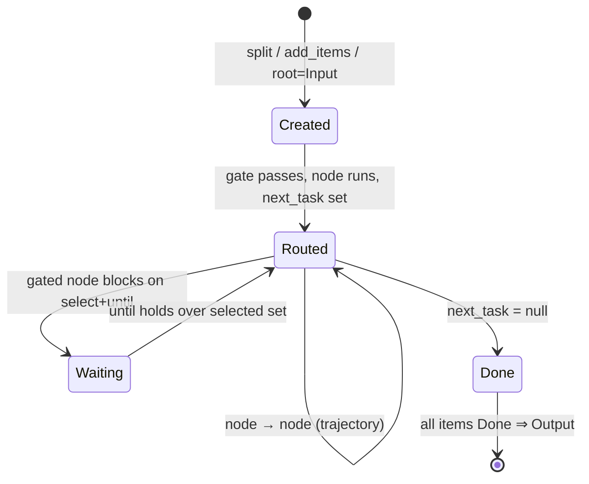
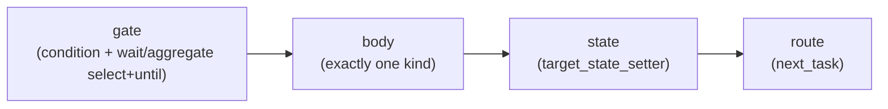
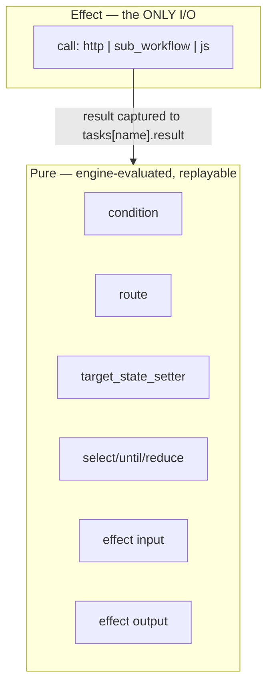
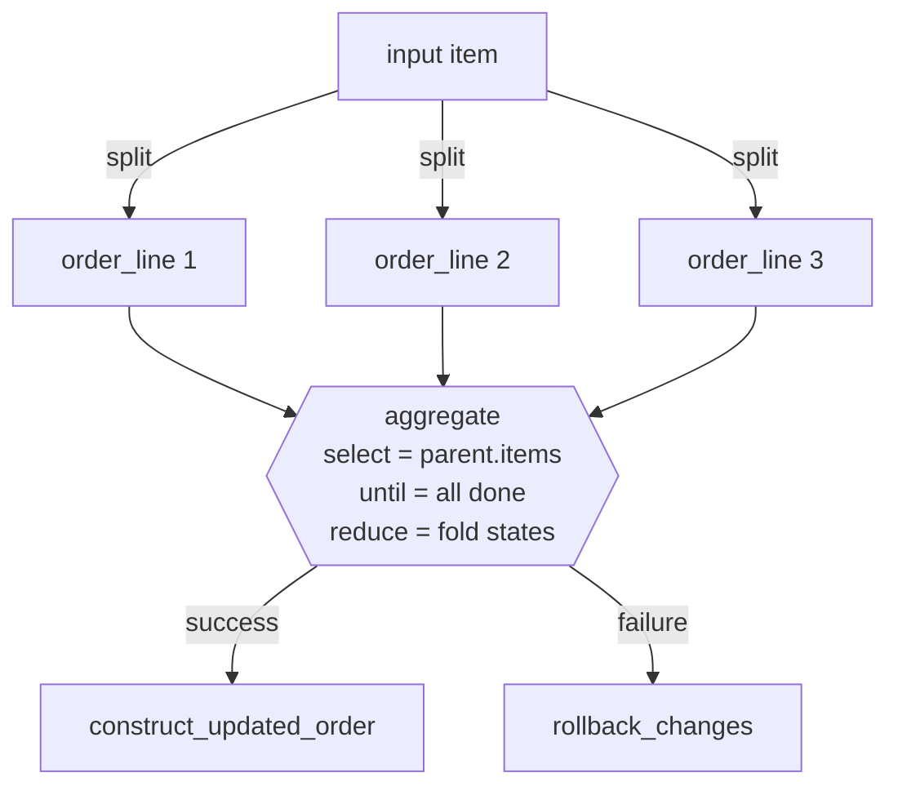
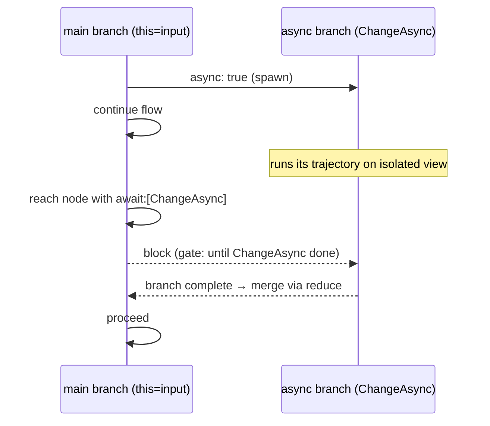
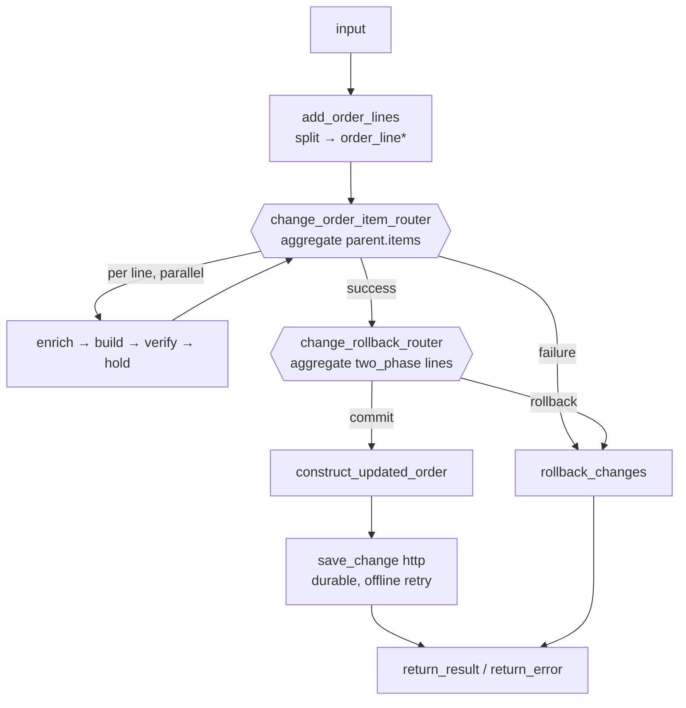

# AFlow — Workflow / Rule Engine Specification

> Status: **Draft for review** · Date: 2026-07-23
>
> This document specifies the AFlow workflow engine, the JSON representation of a
> workflow, the human-authored **hjson** form, and the **TypeScript DSL** that
> produces it. 

---

## Table of contents

1. [Goals & non-goals](#1-goals--non-goals)
2. [Core concepts](#2-core-concepts)
3. [The Item model](#3-the-item-model)
4. [The node model — one primitive, four phases](#4-the-node-model--one-primitive-four-phases)
5. [Expressions vs. effects (the determinism boundary)](#5-expressions-vs-effects-the-determinism-boundary)
6. [Body kinds](#6-body-kinds)
7. [Aggregation, waiting & joins](#7-aggregation-waiting--joins)
8. [Async transitions & determinism](#8-async-transitions--determinism)
9. [Effect tasks, external code & bundles](#9-effect-tasks-external-code--bundles)
10. [Types & the `definitions` block](#10-types--the-definitions-block)
11. [Retry mechanism](#11-retry-mechanism)
12. [Execution algorithm](#12-execution-algorithm)
13. [The workflow JSON document](#13-the-workflow-json-document)
14. [hjson authoring form](#14-hjson-authoring-form)
15. [The TypeScript DSL](#15-the-typescript-dsl)
16. [JSON Schema (normative skeleton)](#16-json-schema-normative-skeleton)
17. [Worked example](#17-worked-example)
18. [Glossary](#18-glossary)
19. [Engine extensions (E1–E5)](#19-engine-extensions-e1e5)

---

## 1. Goals & non-goals

### Goals

- **Deterministic guidance.** Given a workflow specification and an input, the
  engine drives the input to an `end` state by executing a sequence of tasks. The
  *outcome* (final item tree + result) is a pure function of the specification and
  the recorded effect results — independent of scheduling and timing (§8).
- **Items that split, spawn and merge.** An input "item" may be divided into
  several items along the way, and tasks may create new items. Independent items
  follow independent trajectories (their own task sequences), yet can be
  **aggregated** at join points using selector + wait conditions (§7).
- **Async transitions.** A transition (task start) may fire asynchronously; other
  tasks may wait on it (§8).
- **JavaScript everywhere authors expect code.** Pure expressions and effectful
  task bodies are written in JavaScript/TypeScript. Effect bodies may call external
  APIs using libraries **packed with the workflow** or resolved from an **external
  artifactory** (§9).
- **Three interchangeable representations** with a single semantics: canonical
  **JSON** (§13), hand-authored **hjson** (§14), and a typed **TS DSL** (§15).

### Deliverable artifacts

This specification is realised by four artifacts, each with a well-defined
interface:

1. **Workflow schema definition** — the JSON Schema (`aflow.schema.json`, §16) that
   defines and validates the JSON representation of any workflow.
2. **Workflow DSL definition** — the typed TypeScript DSL (§15) authors use to
   write workflows, with autocomplete and compile-time checks derived from the
   workflow's JSON Schema types (§10). Delivered as `@aflow/dsl` (DSL surface,
   static analyzer, schema codegen and the `aflow` command line) and
   `@aflow/ts-plugin` (a TypeScript language-service plugin giving the editor
   behaviours of §15.9 in any TypeScript-server editor).
3. **DSL → plan compiler / converter** — a tool that compiles a DSL workflow into
   the canonical **plan**: the schema-valid workflow JSON, and its 1:1 hjson form
   (§14). Round-trippable: `DSL → hjson → JSON`.
4. **Workflow evaluation engine** — the runtime that executes a workflow:
   - **input:** a workflow definition (conforming to the schema of artifact 1) plus
     an input request (conforming to the workflow's declared `input` type, §10);
   - **output:** a response conforming to the workflow's declared `result` type, or
     a declared error;
   - **behaviour:** drives the input item deterministically through the task graph
     to an end state per §12, with the guarantees of §8.

   Implemented in TypeScript for Node under `src/` (`@aflow/engine`); its HTTP
   surface is `docs/aflow-api.openapi.yaml`. The extensions it required of §16
   are §19.

### Non-goals

- Not a general programming language. Expressions are pure and side-effect free
  (§5). Arbitrary I/O is confined to declared effect tasks.
- Not a UI/BPMN modeller. The graph is defined in code/JSON, not drawn.
- Distributed scheduling internals (queues, `offline` retry storage) are described
  at the contract level, not as an implementation.

---

## 2. Core concepts

The engine evaluates a **workflow specification** against **input data** and
produces a determined **result** by performing a sequence of **tasks** on parts of
the input.

| Concept | Meaning |
|---|---|
| **Item** | A part of the input (or data created during evaluation) with a unique `id`, a specific sequence of tasks to perform, `data`, working `objects`, and recorded task state. Items form a tree. |
| **Task / node** | A unit of work applied to an item. The workflow is a graph of nodes connected by routing. |
| **`this`** | The item a node currently operates on. Every expression is evaluated with `this` bound to that item, with `parent`, `items` (children) and `root` reachable. |
| **Trajectory** | The ordered sequence of nodes an item actually visits (its `next_task` chain). Independent items have independent trajectories. |
| **target_state** | The item's current disposition (e.g. `success`, `failure`) — the value routing and aggregation branch on. (Renamed from the PDF's `currentState`.) |
| **Workflow context** | The set of all items (including the root) for one request. `this` points at the "current" item; parallel execution makes isolated context copies (§8). |

The workflow specification expresses these flow-control concepts, all through the
single node primitive of §4:

- item **creation** (split / add),
- item **enrichment** (data & attributes),
- item **flow routing** (`next_task`),
- item **grouping / ordering** (selectors),
- item **synchronization** (wait / aggregate / join).

---

## 3. The Item model

An item is the main data component flowing through the workflow. There is exactly
one item structure (following the PDF "Draft"):

```jsonc
{
  "id": "123456",
  "type": "order_line",          // item type; selects which nodes apply
  "parent": "…",                  // id of the item this was split/created from; null for root
  "items": [ /* child items */ ], // items created/split from this one

  "data":    { /* typed payload; for the root this is the workflow input */ },
  "objects": { /* typed working state, grown by `enrich` and effect `output` */ },

  "tasks": {                      // latest record per node this item visited
    "verify_change": {
      "id": "1234567",
      "status": "success",        // success | failure | pending | error
      "started": "2020-12-03T10:15:30+01:00",
      "updated": "2020-12-03T10:15:30+02:00",
      "attempts": 1,              // §19 E2 — visits of this node by this item
      "result": { /* effect/output data */ },
      "error":  { "code": 7001, "category": "TECHNICAL", "message": "…",
                  "data": { /* … */ }, "next_retry": "…", "retry_type": "offline" }
    }
  },

  "trajectory": [                 // §19 E2 — ordered, append-only visit log
    { "seq": 0, "task": "verify_change", "attempt": 1, "status": "success",
      "target_state": "success", "next_task": "make_change",
      "started": "…", "updated": "…", "result": { /* … */ }, "error": null }
  ],

  "next_task": "make_change",   // routing target; null ⇒ this item's branch is complete
  "target_state": "success",      // author-defined disposition
  "logging_context": { "order_id": "123456" },
  "additional_properties": { /* free-form */ }
}
```

**Rules**

- The **root** item is created automatically; its `data` is the workflow input, its
  `next_task` is the default `Input` node (§12).
- Every non-root item has a `parent`: **the item it was split from or created by**
  (root or any descendant).
- `next_task === null` marks the end of an item's branch. When *all* items are
  `null`, evaluation terminates and the default `Output` node maps the root's
  `target_state` to `result` or `error`.
- `tasks[name]` holds the **latest** record for that node, with `attempts`
  counting the visits. Effect results and errors are captured here so
  replay/retry/aggregation read recorded values, never live I/O.
- `trajectory` is the **ordered, append-only** log of visits (§19 E2). A node
  visited twice — a rollback phase, a re-dispatch — appears twice, in order,
  where `tasks[name]` would have kept only the last. Ordering is meaningful
  only *within* one item; see §19 E3 for why there is no cross-item
  chronological log.

Item lifecycle:



---

## 4. The node model — one primitive, four phases

There is **one node primitive** ("task"). A node binds to an **item type** (the
`this` it applies to) and runs up to four ordered **phases**; any phase may be
omitted:



| Phase | Purpose | Purity |
|---|---|---|
| **gate** | `condition` — may this node fire on `this`? Optional `select` + `until` block the node until a set of items satisfies a condition (§7). | pure |
| **body** | Exactly one *kind* (§6): `enrich`, `route`, `split`, `aggregate`, `call`, or `return`. | pure, except `call` |
| **state** | `target_state_setter` computes the item's `target_state`. | pure |
| **route** | Computes `next_task` from `target_state`/expression via `switch`/`cases` or a direct name. | pure |

A node's common (kind-independent) fields:

```jsonc
{
  "name": "verify_change",
  "item": "order_line",        // which item type this node applies to (the `this` binding)
  "condition": { "$expr": "true" },        // gate predicate (default: always)
  "await":  { /* select + until */ },        // optional synchronization (§7)
  "async":  false,                            // fire this node's branch asynchronously (§8)
  "durable": false,                           // persist before running (crash-safe)
  "idempotent": false,
  "timeout": 5000,
  "retry": { /* §11 */ },
  "<bodyKind>": { /* exactly one of §6 */ },
  "target_state_setter": { "$expr": "…" },
  "route": { /* name | switch/cases | expression */ }
}
```

> **`$expr`** marks a **pure JavaScript expression** evaluated against `this` (§5).
> In hjson/DSL it is written as real JS; in JSON it is a string.

---

## 5. Expressions vs. effects (the determinism boundary)

AFlow embeds two — and only two — flavours of code:

### Pure expressions (`$expr`)

Used for `condition`, `route`, `target_state_setter`, `select`, `until`, `reduce`,
effect `input`, and effect `output` transforms. They:

- are evaluated by the engine freely, at any time, possibly repeatedly (scheduling,
  aggregation, replay);
- may read `this` and the reachable tree (`parent`, `items`, `root`, `tasks`),
  plus the whole evaluation context through `ctx` (§19 E3);
- may **not** perform I/O, mutate global state, read the clock/RNG, or depend on
  arrival order. They are deterministic functions of the item tree.

An engine MUST enforce this rather than trust it: naming `Date`, `Math.random`,
`fetch`, `require`, `Promise` or the host scope inside a `$expr`/`$do` is an
error, not an undefined behaviour.

The expression language is JavaScript restricted to pure evaluation : collection filtering/among items —
`items.filter(i => i.type==='order_line')`, quorum —
`set.every(i => i.next_task===null)`, lookups — `parent.objects.order`.

### Effects (declared tasks only)

All I/O (HTTP, sub-workflow, inline JS calling external APIs) happens **only**
inside a `call` body (§6, §9). The effect's **result is captured** into
`this.tasks[name].result`. Downstream expressions read the recorded result, never
the live call. This is what makes determinism-of-outcome (§8) and retry/replay
(§11) sound.

[//]: # (diagram: left:50)


---

## 6. Body kinds

Exactly one body kind per node.

| Kind | Pure? | Purpose |
|---|---|---|
| `enrich` | pure | Write `this.objects` / `this.data` / `logging_context`. |
| `route` | pure | Routing-only node (no body work; just sets `next_task`). |
| `split` (`add_items`) | pure | Create child items from a selector; optionally route + run them (parallel). Type and route may vary per child (§19 E1). |
| `aggregate` (`join`) | pure | General wait-then-reduce over a selected item set (§7). |
| `dispatch` | pure | Re-activate a selected item set onto a computed node — the inverse of `aggregate` (§19 E4). |
| `call` | **effect** | Invoke `http` / `sub_workflow` / `js`; capture result. |
| `return` | terminal | Emit workflow `result` or `error` and end the branch. |

### 6.1 `enrich`

```jsonc
{ "name": "enrich_order_line", "item": "order_line",
  "enrich": { "$do": "objects.order_item = parent.objects.order.order_items.find(oi => oi.id === data.order_item_id)" },
  "route": "build_change_target" }
```

`$do` is a pure statement block that assigns into `this` (`objects`, `data`,
`logging_context`, `optional`, etc.). It performs no I/O.

### 6.2 `route` (router)

```jsonc
{ "name": "verify_change_router", "item": "order_line",
  "route": { "switch": { "$expr": "objects.change_order_process.mode" },
             "cases": { "one_mode": "do_change", "other_mode": null } } }
```

### 6.3 `split` / `add_items`

Creates children of `this`. `selector` returns an array; each element becomes a
child item's `data`. `parallel` runs the produced items concurrently (§8).

```jsonc
{ "name": "add_order_lines", "item": "input",
  "split": {
    "item_type": "order_line",
    "selector": { "$expr": "data.order_item_ids ? data.order_item_ids.map(id => ({order_item_id:id})) : objects.order.order_items.map(oi => ({order_item_id: oi.id}))" },
    "route": "enrich_order_line",
    "parallel": true
  },
  "route": "change_order_item_router" }
```

### 6.4 `aggregate` / `join`

See §7.

### 6.4a `dispatch`

See §19 E4. `aggregate` reads a selected set and folds it into `this`;
`dispatch` selects a set and sets each member's `next_task`. Together they are
how a parent drives its children through a second phase.

### 6.5 `call`

See §9.

### 6.6 `return`

```jsonc
{ "name": "return_result", "item": "input",
  "return": { "result": { "$expr": "objects.change_response" } } }
```

```jsonc
{ "name": "return_error", "item": "input",
  "return": { "error": { "$expr": "({ code:500, category:'TECHNICAL', message:'Something very bad happened', data:{ causes: objects.error_causes } })" } } }
```

---

## 7. Aggregation, waiting & joins

Aggregation is **not** a special mechanism — it is the general form of a gated node.
A node may declare a **selector** (the set to wait on), an **`until`** fire
condition, and a **`reduce`** that folds the set into `this`. All three are pure
expressions evaluated with a chosen `this`.

```jsonc
{ "name": "change_rollback_router", "item": "input",
  "aggregate": {
    "select": { "$expr": "items.filter(i => i.objects?.change_order_process?.transaction_mode === 'two_phase')" },
    "until":  { "$expr": "set.every(i => i.next_task === null)" },
    "reduce": { "$do": "objects.all_committed = set.every(i => i.target_state === 'success')" }
  },
  "target_state_setter": { "$expr": "items.find(i => i.target_state==='failure' && !i.optional) ? 'failure' : 'success'" },
  "route": { "cases": { "success": "construct_updated_order", "failure": "rollback_changes" } } }
```

### The three shapes are one mechanism

- **A — parent barrier (the everyday case).** `select` reads `parent`'s children.
  Because computing a node's input or checking a condition already reads *across*
  items, most joins are simply "wait until my children reach a routing point, then
  read them."
- **B — await this item's own prior work.** `select` = `this` itself; `until`
  reads `this.tasks` or this item's async branches. Sugar: `await: ["ChangeAsync"]`
  (§8) is a B-gate on named branches.
- **C — general.** `this` is any item; `select` an arbitrary item set.



### Determinism constraints (normative)

- `until` MUST be **monotonic**: once true for a set it stays true as members
  finish (e.g. `every(done)`, `count(done) >= n`). No "first to arrive" logic.
- `reduce` MUST be **commutative & associative** over the selected set — the result
  cannot depend on member order.
- A gated node **blocks** (item state `Waiting`) until `until` holds, then runs
  `reduce` → `state` → `route`. Blocking is on data, not wall-clock.

---

## 8. Async transitions & determinism

### Async

- `async: true` on a node spawns a **branch** for its item: the flow continues past
  this node without waiting. The branch runs until its `next_task === null`.
- `parallel: true` on a `split` spawns one branch per produced child.
- Each branch executes on an **isolated write view** of the item tree. `this`
  inside a branch points at that branch's item; the main context's `this` is
  unchanged.



### Determinism guarantee (chosen model: outcome-deterministic)

- **Final item tree + result are scheduling-independent.** Async/parallel tasks may
  run in any order or overlap; the determined outcome is identical.
- This is enforced by three rules:
  1. **Isolated writes.** Concurrent branches merge into shared state **only**
     through a join's `reduce` (§7). Two live branches writing the same `objects`
     path is a **validation error** (detected statically where possible, at runtime
     otherwise).
  2. **Monotone `until` / commutative `reduce`** (§7).
  3. **Captured effects.** Effect results are recorded (§5); replay uses recorded
     values.
- **Timing / side-effect order is NOT guaranteed** (logs may interleave). Authors
  who need ordered side effects must serialize them with an explicit trajectory.

---

## 9. Effect tasks, external code & bundles

A `call` body is the only place I/O happens. It selects one **provider**.

### Common shape

```jsonc
{ "name": "save_change", "item": "input",
  "durable": true, "idempotent": true, "timeout": 4500,
  "retry": { "inline": { "max_count": 0 }, "offline": { "max_count": 10, "interval": "5m" } },
  "call": {
    "provider": "http",
    "input":  { "$expr": "objects.save_request" },
    "request": {
      "method":  "POST",
      "url":     { "$expr": "`${parameters['persistence.base-url']}/orders/${data.order_id}`" },
      "headers": { "$expr": "({ 'content-type': 'application/json' })" },
      "body":    { "$expr": "objects.save_request" }
    },
    "output": { "result_type": "SaveResponse", "error_type": "Error",
                "enrich": { "$do": "objects.save_status = result.status" } }
  },
  "route": "return_result" }
```

### Providers

| provider | description |
|---|---|
| `http` | Declarative HTTP request; retry on 5xx / IO per §11. |
| `sub_workflow` | Invoke another workflow by `name` with computed `input`; its `result`/`error` is captured; offline retries bubble to the root (§11). |
| `js` | **Inline JavaScript** — arbitrary code, may call external APIs. `input` expression feeds it; return value captured as the task result. |

### Inline JS + libraries

```jsonc
{ "name": "score_fraud", "item": "input", "timeout": 30000,
  "call": {
    "provider": "js",
    "implementation": {                     // packaged with the workflow…
      "bundle_name": "fraud-utils",
      "bundle_version": "1.4.0",
      "entry": "com.example.FraudScorer"
    },
    "registry": { "url": "https://artifactory.example.com/npm", "ref": "@org/fraud-utils@1.4.0" }, // …or external artifactory
    "input":  { "$expr": "({ order: objects.order, payments: objects.payments })" },
    "script": "async (input, lib) => { return await lib.score(input); }",
    "output": { "enrich": { "$do": "objects.fraud = result" } }
  },
  "route": "…" }
```

- `implementation.bundle_*` resolves from libraries **packed alongside the
  workflow**; `registry` resolves from an **external artifactory**. Exactly one
  resolution source is required when `script` references external code.
- The `script` runs sandboxed with two arguments: the computed `input` and the
  resolved library namespace `lib`. Its return value (or thrown error) is captured
  like any effect result/error and is subject to retry.
- Because the result is captured, the surrounding **expressions stay pure** and the
  determinism model (§8) holds even though the call itself is effectful.

---

## 10. Types & the `definitions` block

Types are first-class and **travel with the workflow**, exactly as in
`generated.json`.

- **`definitions{}`** — JSON-Schema definitions of every message type
  (`ChangeOrderRequest`, `ChangeOrderResponse`, `Order`, …), typically generated
  from your domain type definitions. `input` and `result` are `$ref`s into it:

  ```jsonc
  "definitions": {
    "input":  { "$ref": "#/definitions/com.example.ChangeOrderRequest" },
    "result": { "$ref": "#/definitions/com.example.ChangeOrderResponse" },
    "com.example.Order": { "type": "object", "properties": { /* … */ } }
  }
  ```

- **Item type declarations** bind each item type's `data`, `objects` and `parent`
  types by `$ref`:

  ```jsonc
  "items": {
    "input":      { "data": { "$ref": "#/definitions/input" }, "objects": { "$ref": "#/definitions/InputObjects" }, "parent": null },
    "order_line": { "data": { "$ref": "#/definitions/OrderOrderData" }, "objects": { "$ref": "#/definitions/OrderObjects" }, "parent": "input" }
  }
  ```

- **TS DSL projection.** In the DSL (§15) the types come from JSON Schema, in
  three steps:
  1. *Sources.* Shared message types live in ordinary JSON Schema files the author
     owns (draft-07 `definitions` or 2020-12 `$defs`), referenced from the workflow
     header's `schemas` under a namespace. Workflow-private shapes (item `objects`,
     call results) MAY instead be declared inline in the header's `types`. Every
     named schema gets a key `<namespace>.<Name>`; inline schemas use the
     workflow's `client_id` as namespace (`<client_id>.<Name>`). Two schemas
     resolving to the same key are an error. `$ref`s MAY point within a file or at
     a relative file path referenced from the same header; remote (`http(s)`)
     refs are not resolved — the build is offline.
  2. *Codegen.* `aflow types` — and the editor plugin, whenever a referenced schema
     file changes — turns every key into a member of `interface SchemaRegistry` in
     `@aflow/dsl`, written to `.aflow/types/<client_id>.<name>.d.ts`. Inside a node
     bound to `hotel_line`, `data.`, `objects.`, `parent.objects.` and `root.data.`
     then autocomplete and type-check from the schemas (§15.4, §15.7).
  3. *Build.* `aflow build` copies every key the workflow references (`input`,
     `result`, `items.*.data`/`objects`, `call.output.result_type`/`error_type`),
     plus everything reachable from them through `$ref`, into `definitions` under
     their `<namespace>.<Name>` keys, rewriting `$ref`s to `#/definitions/…`.
     Unreferenced schemas are not copied; the emitted document stays
     self-contained and the engine never reads schema files.

The engine validates `data`/`objects`/`input`/`result` against the referenced
schemas.

---

## 11. Retry mechanism

Carried over from the reference engine; applies to effect tasks (§9).

- Errors returned by effect tasks carry `retry_type` and `next_retry`. Task
  `retry` config has `inline` (fixed `interval`, `max_count`) and `offline`
  (scheduled, exponentially growing `interval` up to `max_interval`, `max_count`).
- Resolution: a requested retry is reduced to a basic type using the task's config
  and prior errors. `inline_then_offline` tries `inline` first, then `offline`.
  `max_count: 0` disables that tier.
- **Output transformation.** A pure `output` expression may turn even a successful
  response into an error (to trigger a retry) — evaluated as part of output
  transform, before enrich.
- **Sub-workflow retries.** Inline retries stay inside the sub-workflow; offline
  retries return `retry_type=offline` + `next_retry` to the parent, since only the
  root workflow schedules offline retries. The parent re-resolves using the
  sub-workflow task's own `retry` config, so total offline retries are controllable
  from the parent.
- `catch_offline_retry_error: true` stores an offline-retry error in context and
  returns it at the end of flow instead of interrupting execution.

---

## 12. Execution algorithm

```
1. Create root item; root.data = workflow input; root.next_task = "Input".
2. Loop until every item has next_task === null:
     a. Runnable set = items whose next_task node's `condition` passes AND,
        if the node has a gate `select`/`until`, whose `until` holds over `select`.
     b. Pick runnable items (any order — outcome is scheduling-independent):
          - run body (enrich | route | split | aggregate | dispatch | call | return)
          - capture effect result/error into tasks[name]; append to trajectory (§19 E2)
          - run target_state_setter → item.target_state
          - run route → item.next_task (null ends the branch)
     c. `async` nodes / `parallel` splits spawn isolated branches (§8).
     d. Gated nodes with unmet `until` stay Waiting (do not busy-loop).
     e. A `dispatch` body may return ended items to the runnable set (§19 E4).
     f. If no item is runnable, none is in flight, and items remain with a
        non-null next_task, the evaluation is deadlocked — report the blocked
        items and the gate that blocked each (§19 Interpretations).
3. Default "Output" node maps root.target_state → result | error via the terminal
   `return` nodes.
```

Default nodes:

- **`Input`** — creates/fills the root item's `data` from the workflow input; may
  be overloaded to add transformation/filtering.
- **`Output`** — checks `target_state`; on success yields `result`, otherwise
  `error`.

---

## 13. The workflow JSON document

Top-level shape (canonical machine form; equivalent of `generated.json`):

```jsonc
{
  "client_id": "someclient",
  "name": "change_order",
  "version": "<auto>",

  "definitions": { /* §10 — message types; input/result $refs */ },
  "items":       { /* §10 — item type declarations */ },

  "config": {
    "json_descriptor": { "name": "business-domains-schema" },
    "bundles": [ { "name": "fraud-utils", "version": "1.1.1" } ],
    "defaults": {
      "item": {
        "objects": { "errors": [], "tech_errors": [] },
        "target_state": "success",
        "allowed_target_states": ["success", "failure"],
        "default_target_state_setter": { "$expr": "task_state.error ? 'failure' : (target_state==='success' ? (parent?.target_state ?? 'success') : target_state)" }
      },
      "task": {
        "route": { "switch": { "$expr": "target_state" } },
        "default_error_handler": { "item": "common", "$do": "objects.tech_errors.push({ detail: error.message, type: 'https://…/order/common/internal' })" }
      },
      "concurrency": { "max_parallel": 8 },   // §19 E5
      "entry": "Input"                         // §19 E5 — node the root item starts on
    }
  },

  "tasks": [ /* array of nodes (§4) — the graph, connected by `route` */ ]
}
```

Notes:

- `tasks` is an **ordered array of nodes**; edges are implicit in each node's
  `route`. Node `name` is the routing key (`next_task`).
- `config.defaults` supplies default item attributes and default task
  route/error-handling (mirrors the reference `default_properties`).
- `config.bundles` lists libraries packed with the workflow (§9).

---

## 14. hjson authoring form

The hand-authored form is [hjson](https://hjson.github.io/): JSON with comments,
unquoted keys, multiline strings, and trailing-comma tolerance. It maps **1:1** to
the JSON of §13 — `$expr`/`$do`/`script` bodies become readable multiline JS.

```hjson
{
  client_id: someclient
  name: change_order

  tasks:
  [
    {
      name: add_order_lines
      item: input
      // split the order into one child item per order line
      split:
      {
        item_type: order_line
        selector:
          '''
          data.order_item_ids
            ? data.order_item_ids.map(id => ({ order_item_id: id }))
            : objects.order.order_items.map(oi => ({ order_item_id: oi.id }))
          '''
        route: enrich_order_line
        parallel: true
      }
      route: change_order_item_router
    }

    {
      name: change_rollback_router
      item: input
      // wait for all 'two_phase' order lines, then decide commit vs rollback
      aggregate:
      {
        select: "items.filter(i => i.objects?.change_order_process?.transaction_mode === 'two_phase')"
        until:  "set.every(i => i.next_task === null)"
      }
      target_state_setter: "items.find(i => i.target_state==='failure' && !i.optional) ? 'failure' : 'success'"
      route: { cases: { success: construct_updated_order, failure: rollback_changes } }
    }
  ]
}
```

A conforming toolchain provides `hjson → json` and `json → hjson` converters; the
JSON is what the engine loads and what the JSON Schema (§16) validates.

---

## 15. The TypeScript DSL

The DSL is a typed TypeScript front for the §13 document — not a second language.
Every DSL name that corresponds to a document field is spelled exactly as in §13
(snake_case), every §13/§16 field and every body kind and extension (§6, §19) is
expressible, and what the author writes is what runs: expression bodies reach the
JSON verbatim apart from type erasure (§15.8).

It is delivered as two packages (§1 artifact 2):

- **`@aflow/dsl`** — the DSL surface types, the static analyzer, schema codegen and
  the `aflow` command line:
  - `aflow types [--project <tsconfig>]` regenerates the schema typings (§10);
  - `aflow build <entry> [-o <file>]` emits the §13 JSON of the workflow assembled
    in `<entry>`.
- **`@aflow/ts-plugin`** — a TypeScript language-service plugin, enabled through
  `compilerOptions.plugins` in the workflow project's `tsconfig.json`. It runs inside
  the editor's existing TypeScript server, so no separate language server is
  needed, and provides the editor behaviours of §15.9.

### 15.1 Static, multi-file authoring

DSL files are **analysed, never executed**. `aflow build` and the editor plugin read
them through the TypeScript program; `build` is a compile step, not a runtime call.
The DSL functions are inert at runtime (each returns its argument), and an engine
MUST NOT be handed the result of importing a DSL module.

- Task names, item-type names, schema keys, route targets and every other
  non-expression value MUST be literals: strings, numbers, booleans, `null`, object
  and array literals, template literals without substitutions, optionally wrapped in
  `as const`, `satisfies` or parentheses. A computed value (`2 * 1000`, a variable, a
  helper call, a spread) is an error (`not-static`).
- The header, task groups and the assembly MUST be declared at module top level
  (`const X = workflow(…)`, `const G = X.tasks(…)`, `export default X.assemble(…)`).
  Tasks generated by loops or helper functions are an error.
- A workflow MAY span several files. The **entry file** is the one whose default
  export is `X.assemble(…)`; it imports the task groups, which may live in any module
  (typically one per sub-flow). Groups are resolved through the TypeScript checker,
  not by file name.

### 15.2 The workflow header

```typescript
export const wf = workflow({
  client_id: "<client>",              // §13
  name: "<name>",                     // §13
  version: "1.0.0",                   // optional; §13
  schemas: { "<namespace>": "<path>" },     // optional; JSON Schema files (§10)
  types:   { "<Name>": { /* JSON Schema */ } }, // optional; inline schemas (§10)
  input:  "<namespace>.<Name>",       // → definitions.input
  result: "<namespace>.<Name>",       // → definitions.result
  items: {                            // → items (§10)
    "<item>": { data: "<key>" | "input", objects: "<key>", parent: "<item>" | null },
  },
  config: { /* §13 config */ },       // optional
});
```

- `schemas` maps a namespace to a JSON Schema file, by path relative to the header
  file. `types` declares workflow-private shapes inline. Both contribute
  `definitions` keys as §10 describes; `input`, `result`, `items.*.data`,
  `items.*.objects` and `call.output.result_type`/`error_type` MUST name one of those
  keys (`data` MAY also be `"input"`, the workflow input type).
- The item declared with `parent: null` is the root item type (§3); the workflow
  input becomes its `data`.
- `config` mirrors §13 `config`. Wherever §13 holds an expression
  (`default_target_state_setter`, `default_error_handler`'s `$do`, `task.route`),
  the DSL holds an arrow function under the rules of §15.4.
- The header is emitted as the §13 top level: `client_id`, `name`, `version`,
  `definitions` (§10), `items` with `$ref`s into `definitions`, and `config`.

### 15.3 Task groups and assembly

```typescript
export const hotel_tasks = wf.tasks({
  "<task_name>": { item: "<item>", /* §13 node fields minus name/item */ },
});

export default wf.assemble(order_tasks, hotel_tasks /* , … */);
```

- `wf.tasks({…})` declares a **task group**: an object whose property names are task
  names (the §13 node `name`) and whose values are §13 nodes without `name`, with
  `item` naming the item type the node binds to (§4). Every expression position holds
  an arrow function (§15.4).
- At most one body kind per node (§6, §16). The DSL types make a second body kind a
  type error.
- `wf.assemble(G1, G2, …)` defines the workflow as **exactly the listed groups**.
  The emitted `tasks` array is in argument order, then property order within each
  group. A task name declared in two groups is an error (`duplicate-task`); a group
  declared for `wf` but listed in no `assemble` is a warning (`unassembled-group`).

### 15.4 Expressions: parameters are the only way in

Every pure expression position (§5) — and every `$do` position — takes an arrow
function whose **single parameter is an object destructuring pattern** naming members
of the engine's expression scope at that position (§15.5):

```typescript
target_state_setter: ({ items }) =>
  items.some(i => i.target_state === "failure") ? "failure" : "success",

enrich: ({ objects, data }) => { objects.total = data.order_lines.length; },
```

The parameter's type contains exactly the names valid at the position, typed for the
node's item type: `data`/`objects` from the item declaration's schema keys (§10),
`parent` and `root` from the item tree (§3), `items` as the union of the child item
types (discriminated by `type`), `parameters` from `config.parameters`, and
`result` from `call.output.result_type`. In the DSL, `call.output` MUST declare
`result_type`; `result` in `call.output.transform` / `call.output.enrich` is typed
from it. In `split.item_type`, `index` is a `number`. An arrow that reads no scope
name writes `({}) => …`.

Three positions are typed more loosely than the runtime binds them, because an
arrow's parameter type cannot depend on a sibling arrow or on the header being
declared. This is a limit of static typing only; what the engine binds at runtime
(§7, §19 E1) is unchanged:

- `set` is typed as the views of the node item's declared child types (every item
  type when it declares none), not from what `select` returns;
- `data` in `split.item_type` is typed as the union of the child types' `data`
  (each selector element becomes a child's `data`, §6.3), not from the selector's
  return element type;
- the `config` expression positions (`default_target_state_setter`,
  `default_error_handler`, `task.route`) use a header-independent scope: `data` is
  `unknown`, item views are open (any declared type), and `parameters` is a record.

Inside the arrow:

- The only identifiers that MAY be referenced are the destructured parameters, locals
  declared inside the arrow (including nested lambda parameters), and the engine's
  safe globals (`Object`, `Array`, `JSON`, `Math` without `random`, `Number`,
  `String`, `Map`, `Set`, …). The list is the one the engine enforces (§5); the
  analyzer MUST take it from the engine, not from a copy.
- Any other free identifier — a module constant, an import, a helper function, an
  outer local — is an error (`outside-reference`), because the body is shipped as
  source and evaluated where none of those exist. A name the engine forbids (`Date`,
  `fetch`, `Promise`, …) is an error (`forbidden-global`) carrying the engine's
  reason and §5.
- `this` (`this`), `async`/`await` (`async`) and `import()` (`dynamic-import`) are
  errors. `self` (in scope everywhere except `split.item_type`) is the item view the
  engine binds `this` to.
- The parameter MUST be one object pattern of shorthand names: renamed
  (`{ data: d }`), defaulted (`{ data = {} }`), nested or rest elements, a
  non-destructured parameter (`(s) => s.data`), or a name not in scope at the
  position (`({ set })` in a `condition`) are errors (`param-shape`). The body is
  emitted with the parameter names as the engine's bare identifiers, so any other
  binding would change its meaning.
- The body form is fixed by the position. **Value positions** — every position of
  §15.5 except the four statement positions below — MUST use an expression body,
  because the engine yields `undefined` for a `$do` where it expects a value. The
  **statement positions** `enrich`, `aggregate.reduce`, `call.output.enrich` and
  `config.defaults.task.default_error_handler` MAY use either form;
  `default_error_handler` is always emitted as `$do` (§15.8), because the engine
  runs only its `$do`. A block body at a value position is an error (`body-form`).
- A block body (`$do`) MAY assign to members (`objects.x = …`,
  `logging_context.y = …`) and rebind `data`, `target_state` and `next_task` — the
  names the engine copies back to the item.

The same analysis enforces these rules in the editor and in `aflow build`: a
workflow that shows no error in the editor MUST build, and one that builds MUST have
shown none.

### 15.5 Scope per position

*Base* is the scope every item-bound expression sees: `id`, `type`, `data`,
`objects`, `tasks`, `trajectory`, `items`, `parent`, `root`, `next_task`,
`target_state`, `logging_context`, `additional_properties`, `optional`, `parameters`,
`ctx` (§19 E3), `self`.

| Position | Scope |
|---|---|
| `condition`, `await.select`, `aggregate.select`, `enrich`, `split.selector`, `dispatch.select`, `route` (expression or `switch`; also `config.defaults.task.route`), `return.result` / `return.error`, `call.input`, `call.request.*` | base |
| `split.route` (expression or `switch`) | base, bound to the produced child (§19 E1) |
| `dispatch.route` (expression or `switch`) | base, bound to the dispatched item (§19 E4) |
| `await.until`, `aggregate.until`, `aggregate.reduce` | base + `set` (§7) |
| `call.output.transform`, `call.output.enrich` | base + `result`, `input` (§9, §11) |
| `target_state_setter`, `config.defaults.item.default_target_state_setter` | base + `task_state`, `error`, `result` |
| `config.defaults.task.default_error_handler` | base + `error`, `task_state` |
| `split.item_type` (expression) | `data`, `index`, `objects`, `tasks`, `items`, `parent`, `root`, `parameters`, `ctx` — the child does not exist yet (§19 E1) |

An arrow function anywhere else, other than `call.script` (§15.6), is an error
(`not-static`).

### 15.6 Effect code

`call.script` (provider `js`, §9) is **effect** code: it MAY be `async` and receives
`(input, lib)` as ordinary positional parameters; the determinism restrictions of
§5 do not apply to it. It is shipped as source too, so it MUST obey the same
no-outside-names rule as an expression: it may reference only its parameters, its
own locals and the safe globals, and a module constant or import is an error
(`outside-reference`).

```typescript
script: async (input, lib) => await lib.hold(input),
```

### 15.7 Types

The DSL is typed from the workflow's own JSON Schemas (§10): `aflow types` (and the
editor plugin, whenever a referenced schema file changes) generates
`.aflow/types/<client_id>.<name>.d.ts` next to the header file, augmenting
`interface SchemaRegistry` in `@aflow/dsl` with one member per `definitions` key.
Schema keys in the header then complete and type-check, and so does every field
reached from them in an expression. Generated files are build output and SHOULD NOT
be committed. Types flow one way, schema → TypeScript; the DSL does not derive
schemas from TypeScript types.

### 15.8 Emission

`aflow build <entry>` emits a §13 document that the engine runs unchanged:

- An arrow with an **expression body** is emitted as `{ "$expr": "<body>" }`; one
  with a **block body** as `{ "$do": "<body>" }`, without the outer braces and with
  the common indentation removed. The body is type-erased and otherwise verbatim —
  nothing is renamed, comments are kept. The one exception is
  `default_error_handler`, which is always emitted as `$do` (an expression body
  becomes its statement text), because the engine runs only its `$do` member.
- `call.script` is emitted as the full arrow text, parameters included.
- Literal values — including literal route strings, `cases` maps and `null` — are
  emitted as they are written.
- Expression text MUST be taken from the TypeScript source, never from
  `Function.prototype.toString()` of a transpiled or bundled function, so the output
  does not depend on the author's toolchain.
- `definitions` holds `input`/`result` `$ref`s plus the transitive `$ref` closure of
  every referenced schema key (§10). The engine never reads schema files.
- `build` keeps the source location (file, line, column) of every task and every
  expression and exposes it through its API; the locations are not part of the
  emitted JSON.

Any error diagnostic (§15.4, §15.9) fails the build; nothing is emitted.

### 15.9 Editor conformance (artifact 2)

A conforming DSL toolchain (§1 artifact 2) MUST provide, inside a stock
TypeScript-server editor with `@aflow/ts-plugin` enabled, with no manual regeneration
step while editing:

1. **Field completion from the workflow's types** — `data.`, `objects.`, `parent.`,
   `items[0].`, `set[0].` — and `result.` when `call.output.result_type` is given —
   complete and type-check from the schemas of §10 / §15.7.
2. **Name completion** — route targets (`route`, `cases`, `default`, `split.route`,
   `dispatch.route`, `config.defaults.entry`) offer every task of the workflow,
   wherever in the workflow's files it is declared; `item`, `split.item_type` and
   `items.*.parent` offer only declared item types.
3. **Graph diagnostics as you type**, reported in the file where the offending task
   is declared:

   | Check | Severity |
   |---|---|
   | a route, `cases`/`default` value, `split.route`, `dispatch.route` or `config.defaults.entry` names no task (`unknown-task`); a route expression is checked when its type is a union of string literals | error |
   | more than one body kind on a node (§16) (`multiple-bodies`) | error |
   | a route sends an item to a task bound to a different item type — the same item for `route`, a child type for `split.route`/`dispatch.route` (`item-type-mismatch`) | error |
   | a literal `target_state_setter` result outside a declared `allowed_target_states` (`target-state`) | error |
   | a task no route, split, dispatch or entry can reach (`unreachable`) — not reported when a route expression's targets are not a literal union | warning |

4. **Determinism diagnostics inside expressions** — every §15.4 / §15.6 violation
   (`outside-reference`, `forbidden-global`, `this`, `async`, `dynamic-import`,
   `param-shape`, `body-form`), at the offending identifier, parameter or body.
5. **Hover documentation** on DSL fields and body kinds citing the spec section and
   its normative rule — e.g. `aggregate`: "§7 — `until` MUST be monotonic; `reduce`
   MUST be commutative and associative."

### 15.10 Worked example: `book_travel_order`

The booking workflow of the engine's test suite (`test/fixtures/booking-workflow.ts`,
flow in its header comment) in the DSL, split over four files. Excerpt: the header,
the entry file, the root's first task, the barrier and dispatch, and the hotel
line's first phase. The flight group is analogous to the hotel group.

```typescript
// header.ts — types, items, config
import { workflow } from "@aflow/dsl";

export const wf = workflow({
  client_id: "travelco",
  name: "book_travel_order",
  version: "1.0.0",
  schemas: { travelco: "./schemas/travelco.json" },  // BookingRequest, BookingResponse, …
  types: {                                           // workflow-private → "travelco.<Name>"
    OrderObjects:      { type: "object" },
    HotelLineData:     { type: "object" },
    HotelLineObjects:  { type: "object" },
    FlightLineData:    { type: "object" },
    FlightLineObjects: { type: "object" },
    HotelRecord:       { type: "object" },
    HotelHold:         { type: "object" },
  },
  input:  "travelco.BookingRequest",
  result: "travelco.BookingResponse",
  items: {
    order:       { data: "input",                   objects: "travelco.OrderObjects",      parent: null },
    hotel_line:  { data: "travelco.HotelLineData",  objects: "travelco.HotelLineObjects",  parent: "order" },
    flight_line: { data: "travelco.FlightLineData", objects: "travelco.FlightLineObjects", parent: "order" },
  },
  config: {
    bundles: [
      { name: "hotel-supplier", version: "2.1.0" },
      { name: "flight-supplier", version: "1.0.3" },
    ],
    defaults: {
      item: { objects: {}, target_state: "success", allowed_target_states: ["success", "failure"] },
      concurrency: { max_parallel: 8 },
      entry: "Input",
    },
  },
});
```

```typescript
// order.ts — root item: normalise, fan out, barriers, dispatch (excerpt)
import { wf } from "./header";

export const order_tasks = wf.tasks({
  Input: {
    item: "order",
    enrich: ({ objects, data, logging_context }) => {
      objects.payment = data.payment_instrument;
      objects.lines_total = data.order_lines.reduce((sum, l) => sum + l.amount, 0);
      logging_context.order_id = data.order_id;
      logging_context.customer_id = data.customer.id;
    },
    route: "split_order_lines",
  },

  split_order_lines: {
    item: "order",
    split: {
      item_type: ({ data }) => data.product_type === "hotel" ? "hotel_line" : "flight_line", // §19 E1
      selector: ({ data }) => data.order_lines,
      route: ({ type }) => type === "hotel_line" ? "create_hotel_record" : "book_flight",
      parallel: true,
    },
    route: "await_reservations",
  },

  await_reservations: {
    item: "order",
    aggregate: {                                           // §7
      select: ({ items }) => items,
      until: ({ set }) => set.every(i => i.objects.phase === "reserved"),
      reduce: ({ objects, set }) => {
        objects.all_reserved = set.every(i => i.target_state === "success");
      },
    },
    target_state_setter: ({ objects }) => objects.all_reserved ? "success" : "failure",
    route: "commit_or_rollback",
  },

  commit_or_rollback: {
    item: "order",
    dispatch: {                                            // §19 E4
      select: ({ items }) => items,
      // Bound to each dispatched line, not to the order.
      route: ({ root, type, target_state, objects }) =>
        root.objects.all_reserved
          ? (type === "hotel_line" ? "commit_hotel_booking" : "confirm_flight")
          : (target_state === "success"
              ? (type === "hotel_line" ? "release_hotel_hold" : "cancel_flight_booking")
              : (type === "hotel_line"
                  ? (objects.record_id !== undefined ? "discard_hotel_record" : "mark_hotel_abandoned")
                  : "mark_flight_abandoned")),
    },
    route: "await_settlement",
  },

  // … await_settlement, return_result, return_error
});
```

```typescript
// hotel.ts — hotel line, phase 1 (excerpt)
import { wf } from "./header";

export const hotel_tasks = wf.tasks({
  create_hotel_record: {
    item: "hotel_line",
    timeout: 5000,
    call: {
      provider: "js",
      implementation: { bundle_name: "hotel-supplier", bundle_version: "2.1.0" },
      input: ({ data, root }) => ({ line: data, order_id: root.data.order_id, customer: root.data.customer }),
      script: async (input, lib) => await lib.createRecord(input),         // effect code, §15.6
      output: {
        result_type: "travelco.HotelRecord",
        enrich: ({ objects, result }) => { objects.record_id = result.record_id; },
      },
    },
    route: { cases: { success: "hold_hotel_room", failure: "mark_hotel_reserved" } },
  },

  hold_hotel_room: {
    item: "hotel_line",
    timeout: 5000,
    retry: { inline: { max_count: 1, interval: "5ms" } },
    call: {
      provider: "js",
      implementation: { bundle_name: "hotel-supplier", bundle_version: "2.1.0" },
      input: ({ objects, data, root }) => ({ record_id: objects.record_id, line: data, payment: root.objects.payment }),
      script: async (input, lib) => await lib.hold(input),
      output: {
        result_type: "travelco.HotelHold",
        enrich: ({ objects, result }) => { objects.hold_id = result.hold_id; },
      },
    },
    target_state_setter: ({ task_state }) => task_state.status === "success" ? "success" : "failure",
    route: "mark_hotel_reserved",
  },

  // … mark_hotel_reserved, commit_hotel_booking, release_hotel_hold, …
});
```

```typescript
// book_travel_order.ts — the entry file
import { wf } from "./header";
import { order_tasks } from "./order";
import { hotel_tasks } from "./hotel";
import { flight_tasks } from "./flight";

export default wf.assemble(order_tasks, hotel_tasks, flight_tasks);
```

`aflow build book_travel_order.ts` emits, for `hold_hotel_room`:

```jsonc
{ "name": "hold_hotel_room", "item": "hotel_line", "timeout": 5000,
  "retry": { "inline": { "max_count": 1, "interval": "5ms" } },
  "call": { "provider": "js",
            "implementation": { "bundle_name": "hotel-supplier", "bundle_version": "2.1.0" },
            "input":  { "$expr": "({ record_id: objects.record_id, line: data, payment: root.objects.payment })" },
            "script": "async (input, lib) => await lib.hold(input)",     // full arrow text
            "output": { "result_type": "travelco.HotelHold",
                        "enrich": { "$do": "objects.hold_id = result.hold_id;" } } },  // block body, braces dropped
  "target_state_setter": { "$expr": "task_state.status === \"success\" ? \"success\" : \"failure\"" },
  "route": "mark_hotel_reserved" }
```

and `definitions` holding `input`, `result`, the seven inline `travelco.*` types and
the closure of `travelco.BookingRequest` / `travelco.BookingResponse` from
`schemas/travelco.json` (including `travelco.PaymentInstrument`, reached by `$ref`).
Task order in `tasks` is `order_tasks`, then `hotel_tasks`, then `flight_tasks`,
each in property order.

---

## 16. JSON Schema (normative skeleton)

The full schema is delivered as `aflow.schema.json`. Skeleton:

```jsonc
{
  "$schema": "https://json-schema.org/draft/2020-12/schema",
  "$id": "https://aflow.dev/schemas/aflow.schema.json",
  "title": "AFlow workflow",
  "type": "object",
  "required": ["client_id", "name", "definitions", "items", "tasks"],
  "properties": {
    "client_id": { "type": "string" },
    "name": { "type": "string" },
    "version": { "type": "string" },

    "definitions": { "type": "object" },        // JSON-Schema message types; input/result $refs

    "items": {                                   // item type declarations
      "type": "object",
      "additionalProperties": {
        "type": "object",
        "properties": {
          "data":    { "$ref": "#/$defs/typeRef" },
          "objects": { "$ref": "#/$defs/typeRef" },
          "parent":  { "type": ["string", "null"] }
        }
      }
    },

    "config": { "type": "object" },

    "tasks": { "type": "array", "items": { "$ref": "#/$defs/node" } }
  },

  "$defs": {
    "expr": {                                    // pure expression / statement / script
      "oneOf": [
        { "type": "string" },
        { "type": "object", "properties": { "$expr": { "type": "string" } }, "required": ["$expr"] },
        { "type": "object", "properties": { "$do":   { "type": "string" } }, "required": ["$do"] }
      ]
    },
    "typeRef": { "type": ["object", "null"], "properties": { "$ref": { "type": "string" } } },

    "route": {
      "oneOf": [
        { "type": ["string", "null"] },                                   // direct next_task
        { "type": "object", "required": ["cases"],
          "properties": { "switch": { "$ref": "#/$defs/expr" },
                          "cases": { "type": "object", "additionalProperties": { "type": ["string", "null"] } } } }
      ]
    },

    "gate": {                                    // §7 wait/aggregate
      "type": "object",
      "properties": {
        "select": { "$ref": "#/$defs/expr" },
        "until":  { "$ref": "#/$defs/expr" },
        "reduce": { "$ref": "#/$defs/expr" }
      }
    },

    "retry": {
      "type": "object",
      "properties": {
        "inline":  { "type": "object", "properties": { "max_count": { "type": "integer" }, "interval": { "type": "string" } } },
        "offline": { "type": "object", "properties": { "max_count": { "type": "integer" }, "interval": { "type": "string" }, "max_interval": { "type": "string" } } }
      }
    },

    "node": {
      "type": "object",
      "required": ["name", "item"],
      "properties": {
        "name": { "type": "string" },
        "item": { "type": "string" },
        "condition": { "$ref": "#/$defs/expr" },
        "await":     { "$ref": "#/$defs/gate" },
        "async":     { "type": "boolean" },
        "durable":   { "type": "boolean" },
        "idempotent":{ "type": "boolean" },
        "timeout":   { "type": "integer" },
        "retry":     { "$ref": "#/$defs/retry" },
        "target_state_setter": { "$ref": "#/$defs/expr" },
        "route":     { "$ref": "#/$defs/route" },

        // exactly one body kind:
        "enrich":    { "type": "object", "properties": { "$do": { "type": "string" } } },
        "split":     { "type": "object", "required": ["item_type", "selector"],
                       // E1: item_type and route are per-child, so both accept an expression.
                       "properties": { "item_type": { "oneOf": [ { "type": "string" }, { "$ref": "#/$defs/expr" } ] },
                                       "selector": { "$ref": "#/$defs/expr" },
                                       "route": { "$ref": "#/$defs/route" }, "parallel": { "type": "boolean" } } },
        "aggregate": { "$ref": "#/$defs/gate" },
        "dispatch":  { "type": "object", "required": ["select", "route"],       // E4
                       "properties": { "select": { "$ref": "#/$defs/expr" },
                                       "route":  { "$ref": "#/$defs/route" } } },
        "call":      { "$ref": "#/$defs/call" },
        "return":    { "type": "object",
                       "properties": { "result": { "$ref": "#/$defs/expr" }, "error": { "$ref": "#/$defs/expr" } } }
      },
      // A node carries AT MOST ONE body kind
      // (enrich|split|aggregate|dispatch|call|return).
      // A routing-only node omits the body entirely and carries just `route`.
      "allOf": [
        { "not": { "anyOf": [
          { "required": ["enrich", "split"] },     { "required": ["enrich", "aggregate"] },
          { "required": ["enrich", "dispatch"] },  { "required": ["enrich", "call"] },
          { "required": ["enrich", "return"] },    { "required": ["split", "aggregate"] },
          { "required": ["split", "dispatch"] },   { "required": ["split", "call"] },
          { "required": ["split", "return"] },     { "required": ["aggregate", "dispatch"] },
          { "required": ["aggregate", "call"] },   { "required": ["aggregate", "return"] },
          { "required": ["dispatch", "call"] },    { "required": ["dispatch", "return"] },
          { "required": ["call", "return"] }
        ] } }
      ]
    },

    "call": {
      "type": "object",
      "required": ["provider"],
      "properties": {
        "provider": { "enum": ["http", "sub_workflow", "js"] },
        "input":    { "$ref": "#/$defs/expr" },
        "output":   { "type": "object",
                      "properties": { "result_type": { "type": "string" }, "error_type": { "type": "string" },
                                      "enrich": { "$ref": "#/$defs/expr" } } },
        "request":  { "type": "object" },                       // http
        "name":     { "type": "string" },                       // sub_workflow
        "script":   { "type": "string" },                       // js
        "implementation": { "type": "object",
                            "properties": { "bundle_name": { "type": "string" }, "bundle_version": { "type": "string" }, "entry": { "type": "string" } } },
        "registry": { "type": "object",
                      "properties": { "url": { "type": "string" }, "ref": { "type": "string" } } }
      }
    }
  }
}
```

---

## 17. Worked example

A trimmed slice of the `change_order` reference workflow in all three forms,
exercising split → parallel order-lines → change/rollback join → save.

### Flow graph



### JSON (canonical)

```jsonc
{
  "client_id": "someclient",
  "name": "change_order",
  "definitions": {
    "input":  { "$ref": "#/definitions/ChangeOrderRequest" },
    "result": { "$ref": "#/definitions/ChangeOrderResponse" }
    /* … message types … */
  },
  "items": {
    "input":      { "data": { "$ref": "#/definitions/input" }, "objects": { "$ref": "#/definitions/InputObjects" }, "parent": null },
    "order_line": { "data": { "$ref": "#/definitions/OrderLineData" }, "objects": { "$ref": "#/definitions/OrderLineObjects" }, "parent": "input" }
  },
  "config": {
    "defaults": { "item": { "target_state": "success", "allowed_target_states": ["success", "failure"] } }
  },
  "tasks": [
    { "name": "add_order_lines", "item": "input",
      "split": { "item_type": "order_line",
                 "selector": { "$expr": "objects.order.order_items.map(oi => ({ order_item_id: oi.id }))" },
                 "route": "enrich_order_line", "parallel": true },
      "route": "change_order_item_router" },

    { "name": "change_order_item_router", "item": "input",
      "aggregate": { "select": { "$expr": "items.filter(i => i.type==='order_line')" },
                     "until":  { "$expr": "set.every(i => i.next_task === null)" } },
      "target_state_setter": { "$expr": "items.find(i => i.target_state==='failure' && !i.optional) ? 'failure' : 'success'" },
      "route": { "cases": { "success": "change_rollback_router", "failure": "rollback_changes" } } },

    { "name": "save_change", "item": "input", "durable": true, "idempotent": true, "timeout": 4500,
      "retry": { "inline": { "max_count": 0 }, "offline": { "max_count": 10, "interval": "5m" } },
      "call": { "provider": "http",
                "input": { "$expr": "objects.save_request" },
                "request": { "method": "POST",
                             "url": { "$expr": "`${parameters['persistence.base-url']}/orders/${data.order_id}`" },
                             "body": { "$expr": "objects.save_request" } },
                "output": { "result_type": "SaveResponse", "error_type": "Error" } },
      "route": "return_result" }
  ]
}
```

### hjson & DSL

See §14 for the same nodes in hjson, and §15.10 for the DSL form (shown on the
booking workflow rather than `change_order`). The three forms are
interchangeable; JSON is what the engine loads and the schema (§16) validates.

---

## 18. Glossary

| Term | Definition |
|---|---|
| **Item** | A uniquely-identified part of the input (or created during evaluation) that flows through the workflow carrying `data`, `objects`, and task state. |
| **`this`** | The item a node operates on; root of expression evaluation. |
| **Node / task** | A graph vertex applying one body kind to an item type, in four phases (gate/body/state/route). |
| **Trajectory** | The `next_task` chain an item actually visits. |
| **target_state** | The item's disposition that routing/aggregation branch on. |
| **Gate** | A node's fire condition, possibly a wait over a selected item set. |
| **Aggregate / join** | The general `select` + `until` + `reduce` over items; parent-barrier (A), self-await (B) and general (C) are one mechanism. |
| **Branch** | An asynchronously executing trajectory for one item, with isolated writes. |
| **Effect / `call`** | The only I/O-performing body; its result is captured on the item. |
| **Expression (`$expr`/`$do`)** | Pure JavaScript evaluated against the item tree; no I/O. |
| **Bundle / artifactory** | Library source for inline-JS effects — packed with the workflow or resolved from an external registry. |
```

---

## 19. Engine extensions (E1–E5)

Five additions to §16, and three readings of under-specified behaviour, arrived
at while building the evaluation engine (§1 artifact 4). Each addition lands on
one side of the §5 determinism boundary — all five are pure — and none
introduces a third flavour of embedded code.

### E1 — `split` chooses each child's type and route

`split.item_type` and `split.route` were single static strings, so one `split`
produced one item type on one path. Both now accept an expression, evaluated
**once per produced child** with `this` bound to that child:

```jsonc
{ "name": "split_order_lines", "item": "order",
  "split": {
    "item_type": { "$expr": "data.product_type === 'hotel' ? 'hotel_line' : 'flight_line'" },
    "selector": { "$expr": "data.order_lines" },
    "route":    { "$expr": "type === 'hotel_line' ? 'create_hotel_record' : 'book_flight'" },
    "parallel": true
  },
  "route": "await_reservations" }
```

`split.route` takes the full `route` shape of §16 — a name, a `$expr`, or
`switch`/`cases` — so a child can be routed on its own `data` without a
router node standing in the way.

While evaluating `item_type` the child does not exist yet, so the scope is
narrowed to `data` (the selector element), `index` (its position, which is
deterministic because the selector is pure), `parent`, `root`, `parameters` and
`ctx`. `route` is evaluated afterwards, against the real child.

Without E1 this is expressible only by splitting into one type and immediately
routing through a dispatcher node; item types then cannot differ per child at
all.

### E2 — the trajectory is ordered and append-only

`tasks` is keyed by node name, so it holds one record per node. Two things get
lost: the order of visits, and every visit but the last. Both matter to the
engine's own contract — §11 retries and E4's second phase both revisit a node.

Each item therefore carries `trajectory`, an append-only array (§3), and each
`tasks[name]` record carries `attempts`. One entry per visit:

```jsonc
{ "seq": 3, "item_id": "1.1", "item_type": "hotel_line",
  "task": "commit_hotel_booking", "attempt": 1, "status": "success",
  "started": "…", "updated": "…",
  "target_state": "success", "next_task": "mark_hotel_settled",
  "result": { "confirmation": "HTL-…" }, "error": null }
```

`seq` numbers the visits **of one item**, which is scheduling-independent: an
item has one `next_task`, so its visits are strictly sequential. The engine also
keeps a flat cross-item log in completion order, surfaced as
`Evaluation.trajectory` for diagnostics. That log is scheduling-*dependent* and
is therefore deliberately unreachable from expressions — see E3.

### E3 — `ctx`: the evaluation context, order-free

Expressions could reach `this`, `parent`, `items` and `root`, which is the item's
own neighbourhood. Routing decisions that depend on the wider evaluation — what
another subtree decided, whether some node ran anywhere, how many items exist —
had nowhere to read from. `ctx` is bound in every pure expression:

| Member | Meaning |
|---|---|
| `ctx.workflow` | `{ client_id, name, version }` |
| `ctx.parameters` | the workflow's parameters |
| `ctx.items` | every item in the evaluation, flat, in **creation** order |
| `ctx.item(id)` | one item by id |
| `ctx.byType(type)` | items of an item type |
| `ctx.byTask(task)` | items that have visited a node |
| `ctx.visits(task)` | every recorded visit of a node, ordered by (item creation, `seq`) |
| `ctx.trajectory(id?)` | one item's ordered visits, or a per-item map |
| `ctx.count(type?)` | item count |

**`ctx` is order-free by construction, and that is normative.** §8 forbids an
expression depending on arrival order, so `ctx` exposes no accessor returning a
global chronological log. The two orderings it does expose are both pure
functions of the specification and the recorded effect results:

- *creation order*, which follows the `split` selectors — themselves pure;
- *per-item `seq`*, which follows one item's strictly sequential trajectory.

An engine MUST NOT add a cross-item chronological accessor to `ctx`. The flat
log of E2 stays on the response, outside expression scope.

### E4 — `dispatch`: re-activating a set of items

§17's `change_rollback_router` sits on the parent and routes to
`rollback_changes` after its children have reached `next_task === null`. Nothing
in §3–§12 says how those children resume: `null` ends a branch, and no
construct sets another item's `next_task`.

`aggregate` selects a set and folds it into `this`. `dispatch` is its inverse —
it selects a set and gives each member a `next_task`:

```jsonc
{ "name": "commit_or_rollback", "item": "order",
  "dispatch": {
    "select": { "$expr": "items" },
    "route":  { "$expr": "root.objects.all_reserved ? 'commit_hotel_booking' : 'release_hotel_hold'" }
  },
  "route": "await_settlement" }
```

`route` is evaluated once per selected item with `this` bound to that item, so
one dispatch fans a heterogeneous set onto different nodes. It is pure: it
writes `next_task`, nothing else. Its task record lists what it dispatched, and
each re-activated item records its own subsequent visits (E2).

Rules:

- Dispatching an item that is **mid-visit** is an error — `dispatch` re-activates
  branches that have ended, it does not preempt running ones.
- A `null` route leaves the branch ended, so `dispatch` can also be a no-op for
  part of the set.
- Because the re-activated items run their own trajectories, a parent that
  dispatches normally follows it with a second `aggregate` barrier. The two
  barriers need distinguishable `until` conditions; the natural form is a
  monotonically advancing marker in `objects` (`reserved` → `settled`), which
  satisfies §7's monotonicity requirement.

Without E4 the same flow is expressible child-side — each child holds its own
`aggregate` gate over `root.items` and decides for itself — but the
parent-driven form the specification's own example uses is not.

### E5 — bounded concurrency and an explicit entry node

```jsonc
"config": { "defaults": {
  "concurrency": { "max_parallel": 8 },
  "entry": "Input"
} }
```

`max_parallel` caps simultaneously-running `call` bodies. It is a resource
control only: §8 guarantees the outcome does not depend on scheduling, so
changing the cap MUST NOT change the result. `entry` names the node the root
item starts on, defaulting to `Input` and then to the first node bound to the
root item type.

### Interpretations of under-specified behaviour

**A gate that never opens is a deadlock, not a skip.** §12 step 2a puts
`condition` in the same position as `until`, so a false `condition` **blocks**
the item rather than skipping the node. When no item can progress and the
evaluation is not terminal, the engine reports which items are blocked, on which
node, and whether it was `condition` or `until` — it does not spin and does not
silently drop the branch. Authors who want "skip this node" should write it as
routing, not as a condition.

**`async: true` routes before it runs.** §8 says the flow "continues past this
node without waiting", and the sequence diagram has the main branch reach an
`await:[…]` node while the branch is still in flight. For that to hold, the
node's `state` and `route` phases run on the pre-body item and the body becomes
a detached branch, which writes `tasks[name]` — `pending` at spawn, then the
settled record — and appends both to the trajectory. `await: ["NodeName"]` is
sugar for a gate that blocks until every named branch on this item has settled.

**§8 rule 1 is enforced at runtime.** Two concurrently live branches assigning
the same top-level `objects` key on the same item raises an error naming the
item, the path and the second writer. Attribution is per-write, at top-level-key
granularity; deep aliasing between branches (`objects.a.b`) is out of scope.

**Termination without a `return` node.** If no `return` body ran, the default
`Output` node maps the root's `target_state`: `failure` yields a declared error,
anything else yields `root.objects.result`.
